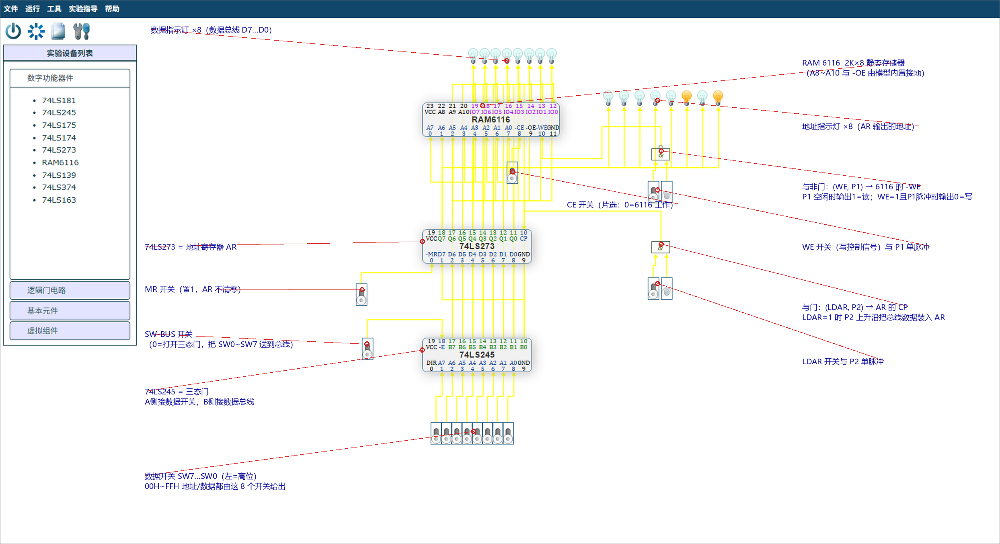

# 实验四 存储器实验 —— 电路已生成 + 操作指导

对应教材《计算机组成原理实验教程》（张雯雰主编）**第 4 章 存储器实验**（书页 17–20，PDF 第 27–30 页）。
教材 4.5 要求的全部操作（向 01H~05H 依次写入 11H~15H 再读回）已在无头浏览器里按步骤跑通，**5/5 全部正确**。

## 一、怎么把它放进实验室

| 方式 | 操作 |
|---|---|
| **A. 打开存档文件（推荐）** | 实验室页面 → 菜单 **文件 → 打开** → 选择 `ai-bridge/out/memory-lab.txt`。36 个元件和 65 条连线立刻出现。 |
| **B. 控制台注入** | 打开实验室页面 → F12 → 把 `ai-bridge/out/memory-lab.console.js` 全文粘贴回车。 |



## 二、电路里有什么（对照教材图 4-1）

| 位置 | 元件 | 作用（教材原文） |
|---|---|---|
| 顶部一排 8 个灯 | 发光二极管 ×8 | **数据显示灯**，显示数据总线上的内容 |
| 上方中间 | **RAM 6116**（2K×8） | 静态存储器。A8~A10 与 -OE 接地（本系统模型已内置为 0，无需连线，与实际容量 256 字节一致） |
| 中部 | **74LS273 = 地址寄存器 AR** | 由 P2 上升沿把总线上的地址装入 AR，AR 输出即 6116 的 A0~A7 |
| 右上 8 个灯 | 发光二极管 ×8 | **地址显示灯**，显示 AR 里的地址 |
| 下部 | **74LS245 = 三态门** | SW-BUS=0 时把 SW0~SW7 送上数据总线；=1 时输出高阻，断开开关 |
| 底部一排 8 个开关 | 开关 = **SW7…SW0**（左为高位） | 地址与数据都由这 8 个开关设置 |
| 右侧 | **与非门** + WE 开关 + P1 单脉冲 | (WE, P1) → 6116 的 -WE。P1 空闲时输出 1=读；WE=1 且 P1 出脉冲时输出 0=写 |
| 右侧 | **与门** + LDAR 开关 + P2 单脉冲 | (LDAR, P2) → AR 的 CP。LDAR=1 时 P2 的上升沿装入地址 |
| 左侧 | MR 开关 | 接 74LS273 的 -MR，置 1 则 AR 不清零 |
| 6116 上方 | CE 开关 | 接 6116 的 -CE，=0 时芯片工作（片选） |
| 245 左侧 | SW-BUS 开关 | 接 74LS245 的 -E，=0 打开三态门 |

> 教材 4.3 第 (4) 条写"当 WE=1、P1=1 时 6116 进行写操作"，与 6116 的 -WE 低电平有效一致：
> 所以 **-WE 必须由与非门产生**（WE=1 且 P1 出脉冲时与非输出 0 = 写；P1 空闲时输出 1 = 读，
> 这正好解释教材 4.5 第 (4) ③ 条"此时 WE=1，因而会读出此地址原有数据"）。

## 三、实验步骤（可直接照做）

### 1) 电路预设置（教材 4.5 第 (2) 条，**先设置再开电源**）
- MR = **1**（AR 不清零）
- CE = **1**（6116 未片选）
- SW-BUS = **1**（三态门关闭）
- WE = **1**，LDAR = **0**

### 2) 打开电源（菜单 运行 → 开电源）

### 3) 写操作：把 11H 写入 01H 单元
| 步 | 操作 | 现象 |
|---|---|---|
| ① | SW0~SW7 置 **00000001**（即 SW0=1），SW-BUS=**0** | 数据显示灯显示 01H |
| ② | LDAR=**1**，点一下 **P2** 单脉冲 | 地址显示灯变成 01H（地址已装入 AR） |
| ③ | CE=**0**，WE=**1** | 6116 进入写准备，此刻 -WE=1，会先读出该地址原有数据 |
| ④ | SW0~SW7 置 **00010001**（SW0=1、SW4=1，即 11H） | 数据显示灯显示 11H |
| ⑤ | 点一下 **P1** 单脉冲 | -WE 变 0，把 11H 写入 01H 单元 |
| ⑥ | CE=**1**，SW-BUS=**1** | 6116 暂停工作，三态门关闭 |

> 单脉冲器件第一次点击只是内部计数 0→1（不产生脉冲），**第二次点击才输出脉冲**；脉冲宽度默认 800ms，
> 可在 工具 → 时钟周期设置 里改。

### 4) 读操作：把 01H 单元的数据读出来
① SW0~SW7 置地址 00000001，SW-BUS=0 ② LDAR=1，点 P2（地址装入 AR）
③ **SW-BUS=1 关闭三态门**（否则开关会与 6116 抢总线）④ WE=**0**（-WE=1 = 读），CE=**0**
⑤ 数据显示灯显示读出的数据，应为 **11H** ⑥ 读完后 CE=1、SW-BUS=1

### 5) 完整实验数据（教材 4.5 第 (4) 条）

| 存储单元 | 写入数据 | 实测读出 | 结果 |
|---|---|---|---|
| 01H | 11H | 11H | ✅ |
| 02H | 12H | 12H | ✅ |
| 03H | 13H | 13H | ✅ |
| 04H | 14H | 14H | ✅ |
| 05H | 15H | 15H | ✅ |

（上表是 `verify.js` 在无头浏览器里自动执行同一套步骤得到的实测结果，不是手写预期值。）

## 四、常见坑

1. **先设开关再开电源**：教材要求的预设置必须在开电源之前完成；开电源后每次点开关都会立即传播。
2. **读之前一定要把 SW-BUS 置 1**：否则 74LS245 仍在驱动数据总线，与 6116 的输出冲突，灯上看到的是开关值而不是存储器值。
3. **地址与数据都由同一组 8 个开关给出**：先送地址（配 P2 装入 AR），再送数据（配 P1 写入），顺序不能颠倒。
4. **单脉冲要点两下**（第一下不产生脉冲）。
5. **写地址时若把 LDAR 一直保持 1** 也没问题：与门输出会在 P2 的每个脉冲上重新产生一次上升沿。

## 五、自动复现

```powershell
cd ai-bridge
node gen-memory-spec.js                                   # 重新生成电路规格（坐标/连线按图4-1计算）
node circuit.js build specs\memory.json out\memory-lab.txt # 生成实验室存档并校验引脚方向
node verify.js out\memory-lab.txt --refs out\memory.refs.json --script sim\memory-lab.js --shot out\memory-lab.png
```
最后一条会打印：元件 36、连线 65、路径异常 0、回存语义一致、写地址装入 5/5、读回 5/5。
