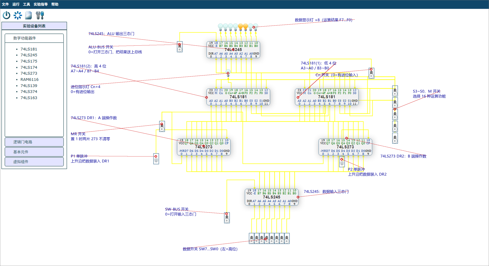

# 实验三 运算器实验 —— 电路已生成 + 操作指导

对应教材《计算机组成原理实验教程》（张雯雰主编）**第 3 章 运算器实验**（书页 12–16，PDF 第 22–26 页）。
按教材 3.5 步骤（DR1=65H、DR2=A7H，再逐项验证表 3-1）已在无头浏览器里跑通，**表 3-1 全部 48 项与教材标准一致**。

## 一、怎么把它放进实验室

| 方式 | 操作 |
|---|---|
| **A. 打开存档文件（推荐）** | 实验室页面 → 菜单 **文件 → 打开** → 选择 `ai-bridge/out/alu-lab.txt`。34 个元件和 75 条连线立刻出现。 |
| **B. 控制台注入** | 打开实验室页面 → F12 → 把 `ai-bridge/out/alu-lab.console.js` 全文粘贴回车。 |



## 二、电路里有什么（对照教材图 3-1 / 3-2）

| 位置 | 元件 | 作用 |
|---|---|---|
| 顶部 8 个灯 | 发光二极管 ×8 | **数据显示灯**，显示 ALU 的运算结果 F7～F0 |
| 上方 | **74LS245**（ALU 输出三态门） | ALU-BUS=0 时把运算结果送到数据总线/显示灯 |
| 中部左 | **74LS181(2)** | 高 4 位算逻运算（A7～A4、B7～B4），其 Cn+4 送外接进位灯 |
| 中部右 | **74LS181(1)** | 低 4 位算逻运算（A3～A0、B3～B0），其 Cn+4 接 ALU(2) 的 Cn |
| 中部左小灯 | 发光二极管 | **进位指示灯**，显示 Cn+4（0=有进位输出） |
| 下方左 | **74LS273 = DR1** | A 端操作数寄存器，P1 上升沿装入 |
| 下方右 | **74LS273 = DR2** | B 端操作数寄存器，P2 上升沿装入 |
| 底部 | **74LS245**（数据输入三态门） | SW-BUS=0 时把开关 SW0～SW7 送上数据总线 |
| 最底 8 个开关 | 开关 SW7…SW0（左=高位） | 置操作数 |
| 右侧 5 个开关 | S3、S2、S1、S0、M | 选择 16 种运算功能 / 算术或逻辑模式 |
| 右侧上 | Cn 开关 | 最低位进位输入（0=有进位，1=无进位） |
| 左侧 | MR 开关 | 两片 74LS273 的清零端，置 1 才不清零 |
| 左侧 | P1、P2 单脉冲 | 分别把数据装入 DR1、DR2 |
| 左侧 / 中下 | ALU-BUS、SW-BUS 开关 | 两个三态门的使能 |

> **连线要点**（与图 3-1 一致）：数据开关→74LS245(A 侧)；245 的 B 侧即数据总线，接 DR1、DR2 的 D 端；
> DR1 的 Q 端接两片 181 的 A 端（Q0～Q3→A0～A3，Q4～Q7→A4～A7），DR2 的 Q 端接 B 端；
> 181(1) 的 F0～F3、181(2) 的 F0～F3 接另一片 245 的 A 端，其 B 端接显示灯；
> 181(1) 的 Cn+4 接 181(2) 的 Cn（串行进位链）；S3～S0、M 并联到两片 181。

## 三、实验步骤（可直接照做）

### 1) 电路预设置（开电源之前）
- **ALU-BUS = 1**（关闭 ALU 输出三态门）
- **MR = 1**（两片 74LS273 不清零，否则一直处于清零状态）
- SW-BUS = 1、Cn = 1、S3S2S1S0 = 0000、M = 0

### 2) 打开电源（菜单 运行 → 开电源）

### 3) 向 DR1、DR2 置数（教材 3.5 第 (4) 条，DR1=65H、DR2=A7H）
| 步 | 操作 |
|---|---|
| ① | **SW-BUS = 0**，打开数据输入三态门 |
| ② | SW7…SW0 置 **01100101**（=65H） |
| ③ | 点 **P1** 单脉冲，上升沿把数据装入 **DR1** |
| ④ | SW7…SW0 置 **10100111**（=A7H） |
| ⑤ | 点 **P2** 单脉冲，上升沿把数据装入 **DR2** |
| ⑥ | **SW-BUS = 1**，关闭数据输入三态门 |

### 4) 检验 DR1、DR2（教材 3.5 第 (5) 条）
| 步 | 操作 | 现象 |
|---|---|---|
| ① | **ALU-BUS = 0**，打开 ALU 输出三态门 | — |
| ② | **Cn = 1**（无进位输入） | — |
| ③ | S3S2S1S0M = **00000**（S=0000, M=0 → F=A） | 显示灯应显示 **01100101（65H）** |
| ④ | S3S2S1S0M = **10101**（S=1010, M=1 → F=B） | 显示灯应显示 **10100111（A7H）** |

### 5) 逐项验证表 3-1（教材 3.5 第 (6) 条）
依次把 S3、S2、S1、S0 按 0000→1111 改变，先置 **M=0**（算术运算，Cn=1）记录显示灯值；
再置 **M=1**（逻辑运算）记录显示灯值，填入表 3-1。

## 四、表 3-1 运算器功能验证（A=65H，B=A7H，实测值）

> 记法按教材：**+ 表示逻辑或，plus 表示算术求和**。Cn=0 表示"有进位输入"，相当于再 +1。

| S3 S2 S1 S0 | 算术功能（M=0，Cn=1） | 输出值 | （Cn=0 时） | 逻辑功能（M=1） | 输出值 |
|---|---|---|---|---|---|
| 0 0 0 0 | A | **65H** | 66H | Ā | **9AH** |
| 0 0 0 1 | A+B | **E7H** | E8H | (A+B)̄ | **18H** |
| 0 0 1 0 | A+B̄ | **7DH** | 7EH | ĀB | **82H** |
| 0 0 1 1 | 0 minus 1 | **FFH** | 00H | Logical 0 | **00H** |
| 0 1 0 0 | A plus AB̄ | **A5H** | A6H | (AB)̄ | **DAH** |
| 0 1 0 1 | (A+B) plus AB̄ | **27H** | 28H | B̄ | **58H** |
| 0 1 1 0 | A minus B minus 1 | **BDH** | BEH | A⊕B | **C2H** |
| 0 1 1 1 | AB̄ minus 1 | **3FH** | 40H | AB̄ | **40H** |
| 1 0 0 0 | A plus AB | **8AH** | 8BH | Ā+B | **BFH** |
| 1 0 0 1 | A plus B | **0CH** | 0DH | (A⊕B)̄ | **3DH** |
| 1 0 1 0 | (A+B̄) plus AB | **A2H** | A3H | B | **A7H** |
| 1 0 1 1 | AB minus 1 | **24H** | 25H | AB | **25H** |
| 1 1 0 0 | A plus A | **CAH** | CBH | Logical 1 | **FFH** |
| 1 1 0 1 | (A+B) plus A | **4CH** | 4DH | A+B̄ | **7DH** |
| 1 1 1 0 | (A+B̄) plus A | **E2H** | E3H | A+B | **E7H** |
| 1 1 1 1 | A minus 1 | **64H** | 65H | A | **65H** |

**两个典型的算术结果**：
- 65H + A7H = **10CH** → 低 8 位 **0CH**，进位输出使 **Cn+4 = 0**（进位灯灭）；
- 65H − A7H − 1 = **BDH**（负数用补码表示），若令 Cn=0 则得 65H − A7H = **BEH**。

## 五、思考与分析（教材 3.6）

**（1）运算器主要由哪些器件组成？这些器件是怎样连接的？**
主要由两片 4 位 ALU **74LS181**（串行级联成 8 位）、两片 8 位数据锁存器 **74LS273**（DR1、DR2 作工作寄存器）、
两片三态总线收发器 **74LS245**（数据输入三态门、ALU 输出三态门），以及数据开关和指示灯组成。
数据开关经 74LS245 送上数据总线，总线同时接 DR1、DR2 的 D 端；DR1 的 Q 端接两片 181 的 A 端，
DR2 的 Q 端接 B 端；181(1) 做低 4 位、181(2) 做高 4 位，181(1) 的 Cn+4 接 181(2) 的 Cn 构成进位链；
运算结果 F0～F7 经另一片 74LS245 送数据显示灯；S3～S0、M 并联接两片 181 的功能选择端，Cn 接最低位进位输入。

**（2）74LS181 没有减法，A minus B 指令怎样实现减法功能？**
用补码把减法化成加法：A − B = A + B̄ + 1。
- 方法一：把 B 先经反相器取反后接 181 的 B 端，选 S=1001（A plus B）并令 **Cn=0**（有进位输入，即 +1），得 A + B̄ + 1；
- 方法二（本实验电路不需要额外反相器）：直接选 **S=0110**（A minus B minus 1），再令 **Cn=0**，即得 A − B。
  实测：S=0110、Cn=1 时输出 BDH（即 A−B−1）；Cn=0 时输出 BEH = 65H − A7H ✓。

**（3）74LS181 有两种级联方法，分别要用到哪些引脚？哪种速度更快？实验用的是哪种？**
- **串行进位（行波进位）**：低位片的 **Cn+4** 接高位片的 **Cn**，只用两个引脚，接线简单；
  但高位必须等低位进位产生后才能稳定，进位延迟逐级累加，速度慢。
- **并行进位（先行进位）**：用每片的 **P（进位传递）、G（进位产生）** 输出，配合先行进位发生器（如 74LS182）
  同时产生各级进位，速度快，但要额外芯片和连线。
- 本实验两片 181 采用**串行进位**（181(1) 的 Cn+4 直接接 181(2) 的 Cn），因为只有 8 位、级数少，接线简单且速度足够。

## 六、常见坑

1. **教材表 3-1 的"+"是逻辑或，不是加法！**（表下注释：`+ 表示逻辑或，plus 表示算术求和`）
   所以 S=0001 的"A+B"输出是 **E7H**（按位或），而不是 10CH 的低 8 位 0CH；真正的加法是 S=1001 的"A plus B"。
   我第一次按数据手册习惯填参考值，就是在这里差了 4 项。
2. **预设置必须先把 ALU-BUS 置 1、MR 置 1** 再开电源：否则 ALU 输出三态门是打开的（总线上数据乱）、
   两片 273 会一直处于清零状态，DR1/DR2 存不进数。
3. **单脉冲要点两下**：第一下只是内部计数 0→1，不产生脉冲；第二次点击才输出脉冲（宽度默认 800ms）。
4. **置数时先关三态门再改开关**：SW-BUS=1 之后改开关不会影响 DR1/DR2（它们只认 P1/P2 上升沿）。
5. 观察逻辑运算时 **Cn 对结果没有影响**（逻辑运算不产生进位），但 **Cn+4 灯**在算术模式下才有意义。

## 七、自动复现

```powershell
cd ai-bridge
node check-alu-model.js 5 7                        # 单独校验 74LS181 模型与教材表 3-1
node gen-alu-spec.js                               # 重新计算电路坐标与连线
node circuit.js build specs\alu.json out\alu-lab.txt
node verify.js out\alu-lab.txt --refs out\alu.refs.json --script sim\alu-lab.js --shot out\alu-lab.png
```
最后一条会打印：元件 34、连线 75、路径异常 0、回存语义一致、置数 DR1=65H/DR2=A7H、
DR1/DR2 检验通过、**表 3-1 验证 48/48 一致**。
